# 牙科门诊客户管理系统 · Code Wiki

> 本文档为项目级代码知识库，覆盖整体架构、模块职责、关键类与函数、依赖关系及运行方式。
> 最后更新：2026-09-15

## 目录

- [1. 项目总览](#1-项目总览)
- [2. 顶层目录结构](#2-顶层目录结构)
- [3. 整体架构](#3-整体架构)
- [4. 后端（Ktor Server）](#4-后端ktor-server)
  - [4.1 模块布局](#41-模块布局)
  - [4.2 启动与生命周期](#42-启动与生命周期)
  - [4.3 路由清单](#43-路由清单)
  - [4.4 实体表与数据库](#44-实体表与数据库)
  - [4.5 鉴权与权限](#45-鉴权与权限)
  - [4.6 关键服务类](#46-关键服务类)
  - [4.7 配置与依赖](#47-配置与依赖)
- [5. 管理后台（Vben Admin Client）](#5-管理后台vben-admin-client)
  - [5.1 monorepo 整体结构](#51-monorepo-整体结构)
  - [5.2 主应用 apps/web-antd](#52-主应用-appsweb-antd)
  - [5.3 业务视图模块](#53-业务视图模块)
  - [5.4 API 层](#54-api-层)
  - [5.5 路由与权限模式](#55-路由与权限模式)
  - [5.6 状态管理](#56-状态管理)
- [6. 小程序（用户端）](#6-小程序用户端)
  - [6.1 目录结构](#61-目录结构)
  - [6.2 页面清单](#62-页面清单)
  - [6.3 工具层](#63-工具层)
  - [6.4 类型与全局状态](#64-类型与全局状态)
- [7. 三端集成关系](#7-三端集成关系)
- [8. 依赖与构建](#8-依赖与构建)
- [9. 运行方式](#9-运行方式)
- [10. 验证命令](#10-验证命令)
- [11. 模块图示（类图与时序图）](#11-模块图示类图与时序图)
  - [11.1 后端实体类图](#111-后端实体类图)
  - [11.2 后端服务依赖类图](#112-后端服务依赖类图)
  - [11.3 后端鉴权类图](#113-后端鉴权类图)
  - [11.4 管理后台类结构](#114-管理后台类结构)
  - [11.5 小程序工具类结构](#115-小程序工具类结构)
  - [11.6 关键业务时序图](#116-关键业务时序图)
    - [11.6.1 管理端登录与菜单加载](#1161-管理端登录与菜单加载)
    - [11.6.2 小程序微信登录（mock）](#1162-小程序微信登录mock)
    - [11.6.3 小程序 5 步预约](#1163-小程序-5-步预约)
    - [11.6.4 消费录入触发积分与推荐奖励](#1164-消费录入触发积分与推荐奖励)
    - [11.6.5 充值流程（mock 微信支付）](#1165-充值流程mock-微信支付)
    - [11.6.6 文件上传链路](#1166-文件上传链路)
    - [11.6.7 首页内容配置与展示](#1167-首页内容配置与展示)
    - [11.6.8 推荐裂变：注册 → 首次消费奖励](#1168-推荐裂变注册--首次消费奖励)
    - [11.6.9 数据库初始化时序](#1169-数据库初始化时序)
    - [11.6.10 C 端 401 鉴权失效处理](#11610-c-端-401-鉴权失效处理)

---

## 1. 项目总览

**项目名称**：XianTong（显同）— 牙科门诊客户管理小程序

**业务范围**：覆盖 2–3 家连锁牙科门诊的客户预约、充值钱包、会员等级、积分、推荐裂变、优惠券、消费结算、就诊记录、消息中心、首页内容配置等核心业务。

**三端架构**：

| 端 | 技术栈 | 角色 | 鉴权 |
|---|---|---|---|
| 后端 Server | Kotlin + Ktor 3.5 + Exposed ORM + PostgreSQL (R2DBC) + Koin DI | 提供 REST API | JWT（管理端含 RBAC，C 端仅身份校验） |
| 管理后台 Client | Vue 3 + Vben Admin 5.7 monorepo + Ant Design Vue + Pinia + Vite | 门诊/医生/客户/优惠券/积分/推荐/消费等后台管理 | 账密登录 + 后端下发菜单 |
| 用户端 Mini-Program | 微信原生小程序（TypeScript + SCSS） | 患者端预约、钱包、积分、推荐、消息、就诊记录 | 微信 code2Session 换 JWT（当前为 mock） |

**统一域与端口约定**：
- 后端监听 `http://localhost:8080`，对外路径前缀 `/api/admin`（管理端）与 `/api/v1`（C 端）。
- 管理后台 dev server 默认端口 `5173`/`5666`，通过 vite 代理转发到后端。
- 小程序 `API_ORIGIN = http://localhost:8080`，真机预览需改为局域网 IP，上线需 HTTPS 并在微信后台配置 request 合法域名。

---

## 2. 顶层目录结构

```
DentalClinic/
├── app/XianTong/                      # 微信小程序用户端
│   ├── miniprogram/                   # 小程序源码
│   │   ├── pages/                     # 12 个业务页面
│   │   ├── utils/                     # request.ts / api.ts / util.ts / mockData.ts / auth.ts
│   │   ├── types/index.ts             # 全局 TS 类型定义
│   │   ├── app.ts / app.json / app.scss
│   ├── typings/                       # 小程序原生类型补丁（IAppOption 等）
│   ├── package.json / project.config.json / tsconfig.json
│   └── README.md / API_INTEGRATION.md
├── panel/XianTong/                    # 服务端 + 管理后台
│   ├── server/                        # Kotlin/Ktor 后端
│   │   ├── src/main/kotlin/com/dentalclinic/
│   │   │   ├── main.kt                # 入口（EngineMain）
│   │   │   ├── Routing.kt             # 根路由 + CORS
│   │   │   ├── Serialization.kt       # JSON 配置
│   │   │   ├── Security.kt            # 通用安全配置
│   │   │   ├── Koin.kt                # 依赖注入装配
│   │   │   ├── admin/                 # 管理端模块（auth/route/service/entity/dto/util）
│   │   │   ├── user/                  # C 端模块（auth/route/service）
│   │   │   └── common/                # 共享：BaseService / FileUploadService / ReferralRewardService / config
│   │   ├── src/main/resources/
│   │   │   ├── application.yaml        # 端口/DB/推荐分享配置
│   │   │   └── test-data.sql           # 测试种子数据（手动执行）
│   │   └── build.gradle.kts
│   ├── client/                        # Vben Admin 管理后台 monorepo
│   │   ├── apps/web-antd/             # 主应用
│   │   ├── packages/                  # 内部包（@core/effects/preferences/stores/types/...）
│   │   ├── scripts/                    # vsh / turbo-run 工具
│   │   ├── pnpm-workspace.yaml
│   │   └── package.json
│   ├── settings.gradle.kts / build.gradle.kts / gradle/
│   ├── CHANGELOG.md                   # 详细变更日志（强约束）
│   └── README.md
├── doc/                               # 需求文档 + 各模块实现说明 + API 测试报告
│   ├── 牙科门诊客户管理小程序_需求文档.docx
│   └── 各 API/功能模块的 .md 实现说明与测试报告
├── .gitignore / .idea/
└── CODE_WIKI.md                       # 本文档
```

---

## 3. 整体架构

```
┌────────────────────────────────────────────────────────────────────────┐
│                        患者小程序（用户端）                              │
│  微信原生小程序 · wx.request → http://<host>:8080/api/v1/*                │
│  JWT 存 wx.Storage，401 自动清状态并 reLaunch 到 /pages/index/index       │
└──────────────────────────────┬─────────────────────────────────────────┘
                               │ HTTP / JSON
                               ▼
┌────────────────────────────────────────────────────────────────────────┐
│                         Ktor 后端（:8080）                              │
│ ┌─────────────────────────────────────────────────────────────────┐    │
│ │ /api/v1/*  C 端（user 模块，部分 public，部分 UserJwtAuthPlugin）  │    │
│ │ /api/admin/* 管理端（admin 模块，全部需 JwtAuthInterceptor+RBAC） │    │
│ └─────────────────────────────────────────────────────────────────┘    │
│   Serialization · Security · Koin · Routing · AdminModule · UserModule │
│ ┌────────────────┐  ┌─────────────────┐  ┌──────────────────────────┐   │
│ │  StatusPages    │  │  AuditPlugin    │  │  AdminCleanupService     │   │
│ │  统一异常翻译   │  │  审计日志拦截   │  │  定时清理（审计>90天等） │   │
│ └────────────────┘  └─────────────────┘  └──────────────────────────┘   │
└────┬────────────────────────────────────┬───────────────────────────┬─┘
     │ Exposed R2DBC                        │ Koin DI                  │ Ktor HTTP Client
     ▼                                      ▼                          ▼
┌──────────────┐                    ┌─────────────────┐          ┌────────────────┐
│ PostgreSQL   │                    │ Service 实例池  │          │ 飞书/外部 API  │
│ dental_clinic│                    │ （在 Module 里  │          │ （预留）        │
└──────────────┘                    │  手工 new）    │          └────────────────┘
                                    └─────────────────┘
                                     ▲
                                     │
                          ┌──────────┴──────────────┐
                          │                         │
                  ┌───────┴────────┐       ┌────────┴────────┐
                  │  Vben Admin    │       │  SchemaMigration │
                  │  管理后台       │       │  启动幂等迁移    │
                  │  (apps/web-antd)│       └─────────────────┘
                  │                 │
                  │ vite proxy:    │
                  │  /api/admin →8080
                  │  /api/v1   →8080
                  └────────────────┘
```

关键约定：
- **路由命名空间隔离**：C 端公开接口（首页内容、登录）挂在 `userAuthenticated` 之外，其他走 `UserJwtAuthPlugin`；管理端所有路由挂 `/api/admin`，统一过 `JwtAuthInterceptor` + `RbacPlugin`。
- **数据库初始化**：`AdminModule.adminModule()` 启动时先 `SchemaUtils.create()` 建缺失表，再 `SchemaMigration.migrate()` 给已存在表补列与索引，最后 `DataSeedService.seed()` 注入默认管理员、权限、菜单与积分规则等种子数据。整个过程幂等。
- **共享层**：`common/` 包提供 `BaseService`、`FileUploadService`、`ReferralRewardService`、`DBConfig`、`SchemaMigration`、`GlobalConfig`，被 admin 与 user 两端共同引用，避免包循环依赖。
- **统一错误响应**：admin 端 `ApiResponse(code, message, data)` 由 `installAdminStatusPages()` 统一翻译 `ValidationException → 400`、`AuthenticationException → 401`、`ForbiddenException → 403`、`NotFoundException → 404`、`ConflictException → 409`、`Exception → 500`；C 端则由各 route 调用 `UserApiErrors.translateApiError(e, call, "ctx")` 翻译常见 SQL 唯一约束冲突为 409。
- **审计与清理**：`AuditPlugin` 拦截 `/api/admin` 下所有写操作写入 `admin_audit_log`；`AdminCleanupService.start()` 启动每 24 小时清理 90 天前审计、30 天前任务历史/DLQ/通知历史。

---

## 4. 后端（Ktor Server）

### 4.1 模块布局

`server/src/main/kotlin/com/dentalclinic/` 下：

| 路径 | 职责 |
|---|---|
| `main.kt` | 入口：调用 `io.ktor.server.netty.EngineMain.main(args)`，由 Ktor 配置驱动 |
| `Routing.kt` | `configureRouting()`：启用 CORS（允许 localhost:5173/8080/3000、所有写方法与鉴权头），根路径 `GET /` 返回 "Dental Clinic API" |
| `Serialization.kt` | `configureSerialization()`：kotlinx.serialization JSON 配置 |
| `Security.kt` | `configureSecurity()`：通用安全相关 |
| `Koin.kt` | `configureKoin()`：Koin 依赖注入装配 |
| `admin/AdminModule.kt` | 管理端模块入口：初始化 DB、建表、SchemaMigration、DataSeed、StatusPages、adminRouting、静态文件、Cleanup |
| `user/UserModule.kt` | C 端模块入口：仅注册 userRouting（表创建/StatusPages 由 admin 模块统一管理） |
| `admin/auth/` | 管理端 JWT 与 RBAC：JwtConfig、JwtAuthPlugin、RbacPlugin、PasswordEncoder、AdminRedisClient |
| `admin/route/` | 管理端 HTTP 路由文件 |
| `admin/service/` | 管理端业务 service |
| `admin/entity/AdminTables.kt` | Exposed 表对象定义（admin + 业务表全部集中于此） |
| `admin/dto/` | 请求/响应 DTO（按 request/response 分包） |
| `admin/util/` | AuditInterceptor、AdminExtensions、Exceptions、PageQuery |
| `user/auth/` | C 端 JWT：UserJwtConfig、UserJwtAuthPlugin |
| `user/route/` | C 端 HTTP 路由 |
| `user/service/` | C 端业务 service |
| `common/BaseService.kt` | 共享基类（封装 suspendTransaction 等） |
| `common/FileUploadService.kt` | 文件上传服务（被 admin 与 user 共用） |
| `common/ReferralRewardService.kt` | 推荐奖励发放（注册链路与消费链路共用） |
| `common/config/DBConfig.kt` | 数据库连接单例（从 application.yaml 读取） |
| `common/config/GlobalConfig.kt` | 全局配置（如 referral.shareBaseUrl） |
| `common/config/SchemaMigration.kt` | 启动时表结构迁移 |

### 4.2 启动与生命周期

`application.yaml` 声明的模块加载顺序：

1. `Serialization` → 2. `Security` → 3. `Koin` → 4. `Routing`（根路由 + CORS）→ 5. `AdminModule.adminModule()`（建表 → 迁移 → 种子 → StatusPages → admin 路由 → 静态文件 → Cleanup 定时器）→ 6. `UserModule.userModule()`（C 端路由）。

数据库连接：`DBConfig.database` 在第一次访问时按 `application.yaml` 的 `database.url/username/password` 建立 R2DBC PostgreSQL 连接。

### 4.3 路由清单

**管理端路由**（全部挂在 `/api/admin` 下，由 `adminRouting()` 注册，前 4 个 vbenRoutes 与 auth 为公开，其余需 JWT）：

| 路由文件 | 端点（示例） | 权限要求 |
|---|---|---|
| `AuthRoutes.kt` | `POST /auth/login`、`POST /auth/refresh`（公开）；`PUT /password`、`POST /logout`、`GET /profile`（JWT） | — / 已登录 |
| `VbenRoutes.kt` | `GET /user/info`、`GET /auth/codes`、`GET /menu/all`（Vben Admin 适配接口） | 已登录 |
| `UserRoutes.kt` | `GET/POST /users`、`GET/PUT/DELETE /users/{id}`、`PUT /users/{id}/status`、`PUT /users/{id}/password` | `system:user:*` |
| `RoleRoutes.kt` | 角色 CRUD、角色权限分配 | `system:role:*` |
| `MenuRoutes.kt` | 菜单 CRUD | `system:menu:*` |
| `DashboardRoutes.kt` | `GET /dashboard/*` 看板聚合数据 | `dashboard:view` |
| `ConfigRoutes.kt` | 系统配置 CRUD、通知规则/历史 | `system:config:*` |
| `AuditRoutes.kt` | 审计日志查询 | `system:audit:view` |
| `PointsRoutes.kt` | 积分记录、积分规则 CRUD | `points:*` |
| `CouponRoutes.kt` | 优惠券模板与发放记录 CRUD | `coupon:*` |
| `ReferralRoutes.kt` | 推荐关系与奖励记录查询 | `referral:*` |
| `ConsumptionRoutes.kt` | 消费流水查询/录入 | `consumption:*` |
| `BusinessRoutes.kt` | 门店/科室/医生/排班/预约/客户管理 | `business:*` |
| `ContentAdminRoutes.kt` | `/banners`、`/notices` CRUD | `content:view` / `content:manage` |
| `AdminFileRoutes.kt` | `POST /files/upload`、`DELETE /files/{fileName}` | `content:manage` |

**C 端路由**（`/api/v1` 下，由 `userRouting()` 注册，公开与受保护混合）：

| 路由文件 | 端点（示例） | 鉴权 |
|---|---|---|
| `UserAuthRoutes.kt` | `POST /auth/wechat-login`、`POST /auth/refresh` | 公开（mock openid = `mock_openid_${code}`） |
| `UserContentRoutes.kt` | `GET /content/home`（一次返回 `{banners, notices}`） | 公开 |
| `UserProfileRoutes.kt` | `GET /profile/me`、`PUT /profile/me` | JWT |
| `UserWalletRoutes.kt` | 余额、充值记录、消费记录 | JWT |
| `UserRechargeRoutes.kt` | `POST /recharge` 等 | JWT |
| `UserAppointmentRoutes.kt` | 5 步预约链路、查询/取消 | JWT |
| `UserMedicalRecordRoutes.kt` | `GET /medical-records`、`GET /medical-records/{id}` | JWT |
| `UserConsumptionRoutes.kt` | 消费记录 | JWT |
| `UserPointsRoutes.kt` | 签到、积分明细、规则 | JWT |
| `UserReferralRoutes.kt` | 推荐码、奖励记录 | JWT |
| `UserCouponRoutes.kt` | 优惠券列表、领取、核销 | JWT |
| `UserNotificationRoutes.kt` | 站内消息、标记已读 | JWT |
| `FileUploadRoutes.kt` | `POST /files/upload`、`GET /files/{fileName}` | JWT / 公开读取 |
| `TestReferralRoutes.kt` | 推荐链路测试辅助 | — |

### 4.4 实体表与数据库

**数据库**：PostgreSQL，通过 `r2dbc:postgresql://localhost:5432/dental_clinic` 连接，用户 `postgres/postgres`（见 application.yaml 与 [DBConfig.kt](file:///Users/wgp/Desktop/DentalClinic/panel/XianTong/server/src/main/kotlin/common/config/DBConfig.kt)）。所有表对象定义集中于 [AdminTables.kt](file:///Users/wgp/Desktop/DentalClinic/panel/XianTong/server/src/main/kotlin/admin/entity/AdminTables.kt)，按业务域分组：

**Admin 系统表**：
- `AdminUsers`（`admin_user`）：管理员账号，username 唯一
- `AdminRoles`（`admin_role`）：角色，is_system 标识内置不可删
- `AdminUserRoles`（`admin_user_role`）：用户-角色多对多
- `AdminPermissions`（`admin_permission`）：权限点，按 module 分组
- `AdminRolePermissions`（`admin_role_permission`）：角色-权限多对多
- `AdminMenus`（`admin_menu`）：菜单树，menuType ∈ directory/menu/button，含 routePath/component/permissionCode/icon/sortOrder/isVisible/isCache
- `AdminRoleMenus`（`admin_role_menu`）：角色-菜单多对多
- `AdminAuditLogs`（`admin_audit_log`）：审计日志（>90 天由 CleanupService 清理）
- `AdminNotificationRules` / `AdminNotificationHistories`：通知规则与历史
- `AdminSystemConfigs`（`admin_system_config`）：key-value 系统配置

**业务表**：
- **基础数据**：`Clinics`、`Departments`、`Doctors`、`DoctorSchedules`（按周循环排班）、`DoctorClinicRels`（医生-门店多对多）
- **用户/会员**：`Users`（C 端用户，openid/phone 双唯一索引）、`UserWallets`（含 balance/bonusBalance/乐观锁 version）、`WalletTransactions`（资金流水，只追加）、`RechargeRecords`、`MemberLevels`、`UserMemberLevels`、`ConsumptionRecords`（含 originalAmount→discountAmount→couponDeduct→payAmount 结算链路）
- **预约**：`Appointments`（status: pending/confirmed/arrived/completed/cancelled/no_show，含 noShowCount）
- **积分**：`PointsRules`（earn/spend 规则，unitAmount+pointsPerUnit 表达小数比率）、`PointsRecords`（流水，含 expiresAt）、`UserPointsSummary`
- **推荐裂变**：`ReferralRelations`（referrer→referee，rewardStatus: pending/partial/full）、`ReferralRewards`（rewardType: points/balance/coupon，stage: registration/first_consumption/tier/ongoing）
- **优惠券**：`CouponTemplates`（discount/cash/service 三种类型）、`UserCoupons`（couponCode 唯一，status: unused/used/expired）
- **消息**：`Notifications`（站内消息）、`MessageTemplates`（微信消息模板配置）
- **小程序内容**：`MpBanners`（轮播图，含排期 startAt/endAt）、`MpNotices`（公告）
- **文件**：`UploadedFiles`（含 owner_type: user/admin 区分归属）

`ContentLinkType` 常量对象收口轮播/公告的跳转类型：`none` / `page` / `webview`，避免散落字符串字面量。

**SchemaMigration**（[SchemaMigration.kt](file:///Users/wgp/Desktop/DentalClinic/panel/XianTong/server/src/main/kotlin/common/config/SchemaMigration.kt)）：
- 启动时执行 `migrate()`，调用多个子迁移方法。
- 用 PostgreSQL `ADD COLUMN IF NOT EXISTS` 实现幂等。
- 已实现迁移：`consumption_record` 补 7 列、`points_rule.unit_amount` 补列、`points_rule.action_type` 唯一索引（重复时跳过并告警）、`doctor_schedule` 唯一索引、`uploaded_file.owner_type` 补列。
- 任一语句失败只告警不阻断启动。

### 4.5 鉴权与权限

**管理端**（[JwtAuthPlugin.kt](file:///Users/wgp/Desktop/DentalClinic/panel/XianTong/server/src/main/kotlin/admin/auth/JwtAuthPlugin.kt)）：
- `JwtAuthInterceptor` 是 route-scoped 插件，校验 `Authorization: Bearer <token>`，`JwtConfig.verifyToken()` 验签，并要求 `tokenType == "access"`。
- 验证通过后构造 `AdminPrincipal(userId, username, permissions)` 存入 `call.attributes[AdminPrincipalKey]`。
- `Route.authenticated { }` 是包装函数，在子路由上 install 该插件。
- `RbacPlugin`（[RbacPlugin.kt](file:///Users/wgp/Desktop/DentalClinic/panel/XianTong/server/src/main/kotlin/admin/auth/RbacPlugin.kt)）在 JWT 认证后检查 principal 是否有所需 permission，否则返回 403。
- `requirePermission("xxx")` 是路由级权限声明，配合 RBAC 插件执行。
- 密码哈希用 BCrypt（`PasswordEncoder.kt`）；Redis 客户端 `AdminRedisClient` 预留用于会话/缓存。

**C 端**（[UserJwtAuthPlugin.kt](file:///Users/wgp/Desktop/DentalClinic/panel/XianTong/server/src/main/kotlin/user/auth/UserJwtAuthPlugin.kt)）：
- `UserJwtAuthPlugin` 只校验 Bearer token，解析 subject 为 userId 存入 attributes。
- **没有 admin 侧的 permissions 字段**，C 端不做 RBAC，仅做身份校验。
- `UserAuthService.wechatLogin()` 当前为 mock：`openid = "mock_openid_${code}"`，任意 code 都会自动建号发 token，便于本地联调。

### 4.6 关键服务类

**admin/service/**：

| Service | 职责 |
|---|---|
| `AdminAuthService` | 管理员登录、token 签发与刷新、修改密码 |
| `AdminUserService` | 管理员账号 CRUD、状态/密码变更 |
| `AdminRoleService` | 角色 CRUD、权限分配 |
| `AdminMenuService` | 菜单树 CRUD、`/menu/all` 下发 |
| `AdminDashboardService` | 看板聚合：营收、留存、推荐统计、趋势、TOP10 |
| `AdminPointsService` | 积分记录查询、积分规则 CRUD |
| `AdminCouponService` | 优惠券模板 CRUD、发放记录 |
| `AdminReferralService` | 推荐关系与奖励记录查询 |
| `ConsumptionAdminService` | 消费流水查询、消费录入（触发积分与推荐奖励） |
| `BusinessServices.kt` | `ClinicService`/`DepartmentService`/`DoctorService`/`ScheduleService`/`AppointmentAdminService`/`CustomerService` 集中定义 |
| `AdminContentService` | 轮播图/公告 CRUD，含排期与跳转校验 |
| `AdminCleanupService` | 启动定时清理任务（每 24h 清理过期审计/任务/DLQ/通知） |
| `DataSeedService` | 启动种子：默认 super_admin、权限点、菜单、会员等级、积分规则 |

**user/service/**：

| Service | 职责 |
|---|---|
| `UserAuthService` | 微信登录（mock）、token 刷新 |
| `UserProfileService` | `/profile/me` GET/PUT，含会员等级与累计消费计算 |
| `AppointmentService` | 5 步预约链路、查询/取消 |
| `MedicalRecordService` | 就诊记录列表与详情 |
| `ConsumptionRecordService` | C 端消费记录查询 |
| `RechargeService` | 充值（当前 mock，未接微信支付） |
| `PointsService` | 签到、积分明细、规则查询 |
| `ReferralService` | 推荐码、奖励记录、裂变注册解析 |
| `CouponService` | 优惠券领取、列表、核销 |
| `NotificationService` | 站内消息、标记已读 |
| `ContentService` | 首页轮播/公告公开接口（按排期过滤） |

**common/**：
- `BaseService`：封装 `suspendTransaction` 与常用查询助手。
- `FileUploadService`：文件上传/删除/批量删除，`saveFile/deleteFile/batchDeleteFiles` 带 `ownerType` 参数区分 user/admin 归属；含路径越界防护（空字节拦截 + canonicalFile + 前缀比较）。
- `ReferralRewardService`：推荐奖励发放，被 `user.ReferralService`（注册链路）与 `admin.ConsumptionAdminService`（首消链路）共用，避免包循环。

### 4.7 配置与依赖

**application.yaml**（[路径](file:///Users/wgp/Desktop/DentalClinic/panel/XianTong/server/src/main/resources/application.yaml)）：
- `ktor.deployment.port: 8080`
- `ktor.application.modules`：6 个模块装配函数
- `database.url/username/password`：PostgreSQL R2DBC 连接
- `referral.shareBaseUrl`：推荐分享链接前缀（未配置时回落 `example.com` 并打 WARN，上线必须替换）

**build.gradle.kts** 主要依赖（[路径](file:///Users/wgp/Desktop/DentalClinic/panel/XianTong/server/build.gradle.kts)）：
- Ktor 3.5：server-core / netty / cors / content-negotiation / serialization-kotlinx-json / config-yaml / auth / auth-jwt / status-pages / client-core / client-cio
- Exposed ORM：exposed-core / java-time / json / r2dbc（1.3.x，使用 `org.jetbrains.exposed.v1.*` 包名）
- 数据库驱动：postgresql-r2dbc
- 工具：bcrypt、lettuce-core（Redis 异步客户端）、koin-ktor、koin-logger-slf4j、logback-classic
- 测试：kotlin-test、ktor-server-test-host
- Kotlin jvmToolchain(21)

---

## 5. 管理后台（Vben Admin Client）

### 5.1 monorepo 整体结构

`panel/XianTong/client/` 是基于 [Vben Admin](https://github.com/vbenjs/vue-vben-admin) v5.7.0 的 pnpm + turbo monorepo，根 [package.json](file:///Users/wgp/Desktop/DentalClinic/panel/XianTong/client/package.json) 声明：

| 顶层包 | 用途 |
|---|---|
| `apps/web-antd` | 主应用（Ant Design Vue 后台） |
| `packages/@core/*` | 框架核心：base、ui-kit（menu-ui 等）、composables |
| `packages/effects/*` | 业务无关的 effects：layouts、hooks、plugins（vxe-table、echarts、motion） |
| `packages/preferences` | 偏好配置与快照测试 |
| `packages/stores` | 全局 Pinia store |
| `packages/types` | 共享 TS 类型 |
| `packages/utils` / `constants` / `icons` / `styles` / `locales` | 通用工具/常量/图标/样式/多语言 |
| `scripts/vsh` | monorepo 脚本入口（lint / format / check / publint） |
| `scripts/turbo-run` | turbo 任务运行辅助 |

根脚本（关键）：
- `pnpm dev:antd` → `pnpm -F @vben/web-antd run dev`
- `pnpm build:antd`、`pnpm lint`、`pnpm format`、`pnpm check`（含 circular/dep/type/cspell）、`pnpm test:unit`（vitest --dom）、`pnpm test:e2e`（playwright）

`engines`：Node `^20.19.0 || ^22.18.0 || ^24.0.0`，pnpm `>=10.0.0`，`packageManager: pnpm@10.33.0`。

### 5.2 主应用 apps/web-antd

`apps/web-antd/src/` 目录：

| 目录 | 职责 |
|---|---|
| `main.ts` / `app.vue` / `bootstrap.ts` | 应用入口与引导 |
| `preferences.ts` | 本应用偏好（覆盖 `@vben/preferences` 默认），含 `accessMode: 'backend'`、`defaultHomePath: '/dashboard'` |
| `api/` | API 请求层（见 5.4） |
| `views/` | 业务视图（见 5.3） |
| `router/` | 路由：`access.ts`、`guard.ts`、`routes/` |
| `store/` | Pinia store（`auth.ts`、`index.ts`） |
| `layouts/` | 布局组件（BasicLayout、IFrameView） |
| `locales/` | i18n（zh-CN / en-US） |
| `adapter/` | antd 组件适配层 |

**vite 代理**（[vite.config.ts](file:///Users/wgp/Desktop/DentalClinic/panel/XianTong/client/apps/web-antd/vite.config.ts)）：
- `/api/admin` → `http://localhost:8080`（管理端接口）
- `/api/v1` → `http://localhost:8080`（上传素材读取端点，避免管理端裂图）
- `ws: true`、`changeOrigin: true`，不 rewrite

### 5.3 业务视图模块

`apps/web-antd/src/views/` 下：

| 模块目录 | 文件 | 用途 |
|---|---|---|
| `_core/` | fallback、authentication 等 | 框架自带页面 |
| `dashboard/analytics/` | `index.vue` | 看板：4 张指标卡、营收趋势、留存/推荐、门店柱状图、来源环形图、等级分布、推荐 TOP10（ECharts） |
| `system/user/` | `index.vue`、`form-modal.vue` | 管理员账号管理 |
| `system/role/` | `index.vue`、`form-modal.vue` | 角色与权限分配 |
| `system/menu/` | `index.vue`、`form-modal.vue` | 菜单树管理 |
| `system/config/` | `index.vue` | 系统配置 |
| `system/audit/` | `index.vue`、`detail-modal.vue` | 审计日志 |
| `notification/history/`、`notification/rules/` | `index.vue`、`rule-form-modal.vue` | 通知历史与规则（从 `system/notification` 迁出） |
| `clinic/` | `index.vue`、`form-modal.vue` | 门诊管理 |
| `department/` | `index.vue`、`form-modal.vue` | 科室管理 |
| `doctor/` | `index.vue`、`form-modal.vue` | 医生管理 |
| `schedule/` | `index.vue`、`form-modal.vue` | 医生排班 |
| `appointment/` | `index.vue`、`detail-modal.vue` | 预约管理 |
| `customer/` | `index.vue`、`detail-modal.vue`、`adjust-modal.vue` | 客户管理（含钱包人工调整） |
| `coupon/` | `index.vue`、`form-modal.vue`、`record.vue` | 优惠券模板与发放记录 |
| `points/` | `index.vue`、`record.vue`、`form-modal.vue` | 积分记录与积分规则 |
| `referral/` | `index.vue`、`record.vue`、`detail-modal.vue` | 推荐关系与奖励记录 |
| `consumption/` | `index.vue`、`create-modal.vue` 等 | 消费流水 |
| `content/banner/`、`content/notice/` | `index.vue`、`form-modal.vue` | 小程序轮播图与公告配置 |

历史遗留目录（已下线，CHANGELOG 记录）：`game/`、`queue/`、`task/`（项目模板遗留，已删除）。`router/routes/modules/dashboard.ts` 已删，`accessMode: 'backend'` 下菜单全部由后端 `/menu/all` 下发，前端不再维护静态路由模块。

### 5.4 API 层

`apps/web-antd/src/api/` 文件：

| 文件 | 导出函数 |
|---|---|
| `request.ts` | `baseRequestClient`、`requestClient`（基于 `@vben/request`，注入 Authorization/Accept-Language） |
| `core/auth.ts` | `loginApi`、`refreshTokenApi`、`logoutApi`、`getAccessCodesApi` |
| `core/user.ts` | `getUserInfoApi`、`getUserMenuListApi` 等 |
| `core/menu.ts` | `getAllMenusApi`（→ `/menu/all`） |
| `core/index.ts` | re-export |
| `clinic.ts` / `department.ts` / `doctor.ts` / `schedule.ts` | 业务模块标准 CRUD（`getXxx`/`createXxx`/`updateXxx`/`deleteXxx`） |
| `appointment.ts` | 预约管理列表与详情 |
| `customer.ts` | 客户列表、详情、钱包调整 |
| `consumption.ts` | 消费流水 |
| `coupon.ts` | 优惠券模板 CRUD、发放记录 |
| `points.ts` | 积分记录、积分规则 |
| `referral.ts` | 推荐关系、奖励记录 |
| `dashboard.ts` | 看板各统计接口 |
| `content.ts` | 轮播/公告 CRUD、`ContentLinkType` 联合类型 |
| `upload.ts` | `requestClient.upload(url, { file })` 走 FormData |
| `system.ts` | 系统/角色/菜单/审计/通知等综合 API |
| `config.ts` | 系统配置 |

### 5.5 路由与权限模式

`accessMode: 'backend'`（见 `preferences.ts`）含义：
- 菜单树完全由后端 `/api/admin/menu/all` 下发，前端不维护静态菜单配置。
- 登录后调用 `getAllMenusApi()`，`generateAccessible()` 在 [router/access.ts](file:///Users/wgp/Desktop/DentalClinic/panel/XianTong/client/apps/web-antd/src/router/access.ts) 中将后端菜单转成 Vue Router 路由，按 `meta.menuVisibleWithForbidden = true` 可生成 403 兜底路由。
- 权限码由 `/api/admin/auth/codes` 下发，存入 `accessStore.accessCodes`，组件内可用 `AccessControl` 控制按钮可见性。
- 路由守卫在 [router/guard.ts](file:///Users/wgp/Desktop/DentalClinic/panel/XianTong/client/apps/web-antd/src/router/guard.ts)：未登录访问受保护路由重定向到 `/auth/login`，登录态过期触发 `accessStore.loginExpired` 弹窗。

### 5.6 状态管理

`apps/web-antd/src/store/`：
- `auth.ts`：`useAuthStore`，封装 `authLogin`（登录 → 取 token + userInfo + accessCodes → 跳 `userInfo.homePath || preferences.app.defaultHomePath`）、`logout`、`fetchUserInfo`、`loginLoading` 状态。
- `index.ts`：re-export `@vben/stores` 提供的 `useUserStore`、`useAccessStore`、`resetAllStores` 等。

`refreshToken` 存 `localStorage`，由 `refreshTokenApi` 在 body 中携带刷新；access token 存 `accessStore`（基于 `localStorage` 持久化键名 `${namespace}-${version}-${env}-${storeId}`，e2e fixtures 已对该键名动态推导）。

---

## 6. 小程序（用户端）

### 6.1 目录结构

`app/XianTong/miniprogram/`：

```
miniprogram/
├── app.json             # 路由 + tabBar + 窗口样式 + lazyCodeLoading
├── app.ts                # 入口：globalData + 登录态恢复
├── app.scss             # 全局样式
├── types/index.ts        # 全局 TS 类型（用户/会员/就诊/预约/钱包/积分/推荐/优惠券/消息/内容）
├── utils/
│   ├── request.ts        # API 封装：BASE_URL / USE_MOCK / get/post/put/del/uploadFile
│   ├── api.ts            # 接口函数（按模块组织）
│   ├── util.ts           # formatTime、resolveFileUrl
│   ├── auth.ts           # 登录态辅助
│   └── mockData.ts       # USE_MOCK=true 时的全量 mock 数据
├── pages/                # 12 个业务页面（见 6.2）
└── images/               # 图片资源（当前几乎为空，banners 由后端下发）
```

`app/XianTong/` 根：
- `package.json`：`name: miniprogram-ts-sass-quickstart`，仅 devDep `typescript@7.0.2`，脚本只有 `typecheck`
- `project.config.json` / `project.private.config.json`：微信开发者工具项目配置
- `tsconfig.json`：strict TS 配置
- `typings/`：`IAppOption` 等小程序原生类型补丁

### 6.2 页面清单

`app.json` 注册的 12 个页面，tabBar 入口 4 个（首页/预约/钱包/我的）：

| 页面 | 文件 | 用途 |
|---|---|---|
| `pages/index/` | `index.{ts,wxml,scss,json}` | 首页：后端下发轮播图、公告纵向 swiper、快捷入口（emoji 图标）、门店列表 |
| `pages/appointment/` | 4 文件 | 5 步预约：门诊→科室→医生→时段→确认（tabBar 页，用 `globalData.pendingClinicId` 中转） |
| `pages/appointments/` | 4 文件 | 预约记录列表 |
| `pages/recharge/` | 4 文件 | 充值（档位选择/自定义金额，当前 mock） |
| `pages/wallet/` | 4 文件 | 钱包余额、充值/消费记录 |
| `pages/points/` | 4 文件 | 签到、积分明细、规则 |
| `pages/referral/` | 4 文件 | 推荐码、奖励记录 |
| `pages/profile/` | 4 文件 | 个人中心：会员等级卡片、权益、余额、升级进度、入口跳转 |
| `pages/profile-edit/` | 4 文件 | 编辑姓名/昵称/手机号/性别/年龄，头像走 `wx.chooseMedia + uploadFile` |
| `pages/medical-records/` | 4 文件 | 就诊记录列表（分页 + 关键词搜索） |
| `pages/medical-record-detail/` | 4 文件 | 单次就诊详情含消费明细 |
| `pages/messages/` | 4 文件 | 消息中心，读/未读与标记已读 |

### 6.3 工具层

**utils/request.ts**（[路径](file:///Users/wgp/Desktop/DentalClinic/app/XianTong/miniprogram/utils/request.ts)）：
- `API_ORIGIN = 'http://localhost:8080'`（dev），`BASE_URL = ${API_ORIGIN}/api/v1`。
- `USE_MOCK = false`（当前默认接真实后端，可改 true 走 `mockApiService`）。
- `request<T>(options)`：处理 401（清 token + reLaunch 首页）、HTTP 非 200、业务层 `code !== 0` 统一 reject。
- 导出 `get/post/put/del/uploadFile` 五个便捷方法，`uploadFile` 解析容错（后端可能返回非 JSON）。
- `handleAuthExpired`：清 storage + 全局态，已避免重复跳 tabBar。

**utils/api.ts**：
- 按模块组织接口函数（认证、用户资料、门诊/科室/医生、预约、钱包、充值、积分、推荐、优惠券、消息、就诊记录、首页内容）。
- 关键导出：`wechatLogin`、`getUserProfile`、`updateUserProfile`、`getMedicalRecords(page, pageSize, keyword?)`、`getMedicalRecordDetail(id)`、`getHomeContent()`（`needAuth = false`）。
- 类型严格：`updateUserProfile` 返回 `put<null>`（后端只回 code/message）；`UserProfileResponse.nextLevelCost` 为 `number | null`（最高等级时为 null）。

**utils/util.ts**：
- `formatTime(date)`：标准格式化。
- `resolveFileUrl(url)`：把后端相对路径（`/api/v1/files/xxx.png`）拼成绝对地址；对 `//`、`data:`、`wxfile://`、`http://tmp/`、`^https?://` 前缀原样返回（兼容 `wx.chooseMedia` 临时路径与网络图），其余拼 `API_ORIGIN`。

**utils/mockData.ts**：`mockApiService.call(path, method, data)` 路由分发，覆盖用户/门诊/科室/医生/时段/预约/钱包/积分/推荐/优惠券/消息等全量 mock 数据，模拟网络延迟 300ms。

**utils/auth.ts**：登录态辅助封装。

### 6.4 类型与全局状态

**types/index.ts** 按模块分组导出接口：
- 用户与会员：`UserInfo`（含 balance/bonusBalance/nickname）、`MemberLevel`（nextLevelCost 可空）
- 就诊记录：`MedicalRecord`、`ConsumptionDetail`、`MedicalRecordDetail`
- 首页内容：`ContentLinkType`、`Banner`、`Notice`
- 门诊/科室/医生/时段/预约/钱包/积分/推荐/优惠券/消息
- `ApiResponse<T>` 统一响应封装（`code/message/data`，约定 `code === 0` 为业务成功）

**app.ts globalData**：
- `userInfo: UserInfo | null`
- `token: string`
- `clinics: any[]`
- `pendingClinicId: number | null`（首页→预约页的门诊 id 中转，预约页 onShow 读完即清空）
- `setUserInfo`、`setToken`、`setPendingClinicId`、`logout` 同步 storage 与全局态

**`typings/index.d.ts`**：声明 `IAppOption` 接口（含上述 globalData 字段与 setter）。

---

## 7. 三端集成关系

```
管理后台 apps/web-antd                后端 Ktor :8080              小程序 miniprogram
─────────────────────────           ─────────────────            ─────────────────
vite proxy:                          application.yaml:
 /api/admin → :8080                  ktor.deployment.port=8080    API_ORIGIN=http://localhost:8080
 /api/v1   → :8080                   database.url=postgresql       BASE_URL=${API_ORIGIN}/api/v1

登录：账密 → /auth/login              JwtConfig 签发 access+refresh  登录：wx.login code → /auth/wechat-login
  → accessToken + refreshToken         access 携带 permissions        → accessToken + refreshToken
  → /auth/codes 拉权限码              super_admin 全权限              （C 端不做 RBAC，仅身份校验）
  → /menu/all 拉菜单                                                  401 自动清态 + reLaunch 首页
  → generateAccessible 生成路由

写操作 → AuditPlugin 写 admin_audit_log
读操作 → RbacPlugin 校验 requirePermission

轮播图配置：管理端上传图 → AdminFileRoutes
   → uploaded_file(owner_type=admin)
   → mp_banner 表
   → 小程序 GET /content/home 拉取（公开，按 status+排期过滤）
   → resolveFileUrl 拼绝对地址 → <image src> 渲染

推荐裂变：
   小程序分享链接 ?code=<referralCode>
   → 被邀请人打开 → wechatLogin 携带 code
   → user.ReferralService 解析 → 写 referral_relation
   → common.ReferralRewardService 发放 registration 阶段奖励
   → 首次消费时 admin.ConsumptionAdminService 触发 first_consumption 阶段奖励

资金流水对账等式：
   wallet_transaction 逐笔累加 === user_wallet 当前余额
   任何修改 balance/bonusBalance 的路径都必须写一条流水
```

---

## 8. 依赖与构建

### 8.1 后端

| 依赖 | 版本来源 |
|---|---|
| Kotlin | jvmToolchain(21) |
| Ktor | 3.5.x（libs.versions.toml） |
| Exposed | 1.3.x（`org.jetbrains.exposed.v1.*`） |
| PostgreSQL R2DBC | 由 Exposed r2dbc + postgresql-r2dbc 提供 |
| Koin | ktor-logger-slf4j |
| JWT | ktor-server-auth-jwt |
| Logback | classic |
| BCrypt | 用于密码哈希 |
| Lettuce | Redis 异步客户端（预留） |

构建：Gradle Kotlin DSL，`settings.gradle.kts` 包含 `:client`（KMP 客户端占位，未深入使用）与 `:server`。`./gradlew :server:run` 启动，`./gradlew :server:build -x test` 打包。

### 8.2 管理后台

Vue 3 + Vite 7 + turbo + pnpm workspace。关键依赖：`vue`、`ant-design-vue`、`pinia`、`vue-router`、`vxe-table`、`echarts`、`@vben/*` workspace 包、`@iconify/vue`（图标统一走 `@vben/icons`）。

Node `^20.19.0 || ^22.18.0 || ^24.0.0`，pnpm `>=10.0.0`，`packageManager: pnpm@10.33.0`。

### 8.3 小程序

微信原生 + TypeScript 7.0.2 + SCSS，无运行时 npm 依赖（devDependencies 仅 typescript）。`tsconfig.json` strict 模式，`npx tsc --noEmit -p tsconfig.json` 做类型检查。

---

## 9. 运行方式

### 9.1 启动后端

前置：本地 PostgreSQL 监听 5432，库名 `dental_clinic`，账号 `postgres/postgres`（见 [application.yaml](file:///Users/wgp/Desktop/DentalClinic/panel/XianTong/server/src/main/resources/application.yaml)）。库不存在时 R2DBC 不会自动建库，需手工 `CREATE DATABASE dental_clinic;`。

```bash
cd panel/XianTong
./gradlew :server:run
# 启动成功后监听 http://0.0.0.0:8080
# 首次启动自动建表 + SchemaMigration + DataSeed（默认 super_admin / 全权限 / 菜单 / 会员等级 / 积分规则）
```

种子默认管理员：见 `DataSeedService.seed()`（super_admin 角色，含全部权限与菜单）。

### 9.2 启动管理后台

```bash
cd panel/XianTong/client
pnpm install           # 首次或依赖变化时
pnpm dev:antd          # 启动 vite dev server（默认 5666 或 5173）
# 浏览器访问 dev server 地址，登录页用 super_admin 账号登录
```

dev server 自动代理 `/api/admin` 与 `/api/v1` 到 `http://localhost:8080`。

### 9.3 启动小程序

1. 用微信开发者工具打开 `app/XianTong/` 目录。
2. 在 `miniprogram/utils/request.ts` 中确认 `API_ORIGIN`：
   - 模拟器调试：`http://localhost:8080`
   - 真机预览：改为电脑局域网 IP（如 `http://192.168.1.100:8080`），并在「详情 → 本地设置」勾选「不校验合法域名…」
   - 上线：HTTPS 域名 + 微信公众平台配置 request 合法域名
3. `USE_MOCK = false` 时连真实后端，`= true` 时走 `mockData.ts` 离线开发。

### 9.4 生产部署

- 后端：`./gradlew :server:build -x test` 生成 fat jar，由 Netty EngineMain 启动；生产 Nginx 统一转发 `/api/admin`、`/api/v1` 到后端。
- 管理后台：`pnpm build:antd` 产物由 Nginx 托管；生产环境不再需要 vite 代理。
- 小程序：微信开发者工具上传 → 提审。
- `application.yaml` 的 `referral.shareBaseUrl` 必须替换为真实域名。

---

## 10. 验证命令

| 目标 | 命令 | 工作目录 |
|---|---|---|
| 后端编译（强制重编） | `./gradlew :server:cleanCompileKotlin` | `panel/XianTong` |
| 后端测试 | `./gradlew :server:test` | `panel/XianTong` |
| 后端打包 | `./gradlew :server:build -x test` | `panel/XianTong` |
| 管理后台 lint | `pnpm lint` | `panel/XianTong/client` |
| 管理后台类型+循环依赖+依赖+拼写 | `pnpm check` | `panel/XianTong/client` |
| 管理后台单元测试 | `pnpm test:unit` | `panel/XianTong/client` |
| 管理后台 e2e | `pnpm exec playwright test` | `panel/XianTong/client` |
| 小程序类型检查 | `npx tsc --noEmit -p tsconfig.json` | `app/XianTong` |

---

## 11. 模块图示（类图与时序图）

> 以下图示使用 Mermaid 语法，GitHub、VS Code（Mermaid 插件）、Typora 等主流 markdown 查看器原生渲染。
> 类图按"实体表 → 服务依赖 → 鉴权 → 客户端 → 小程序"分层呈现；时序图覆盖 10 条核心业务链路。

### 11.1 后端实体类图

按业务域拆成 4 张图，箭头表示外键引用方向（持有方 → 被引用方）。

#### 11.1.1 Admin 系统表

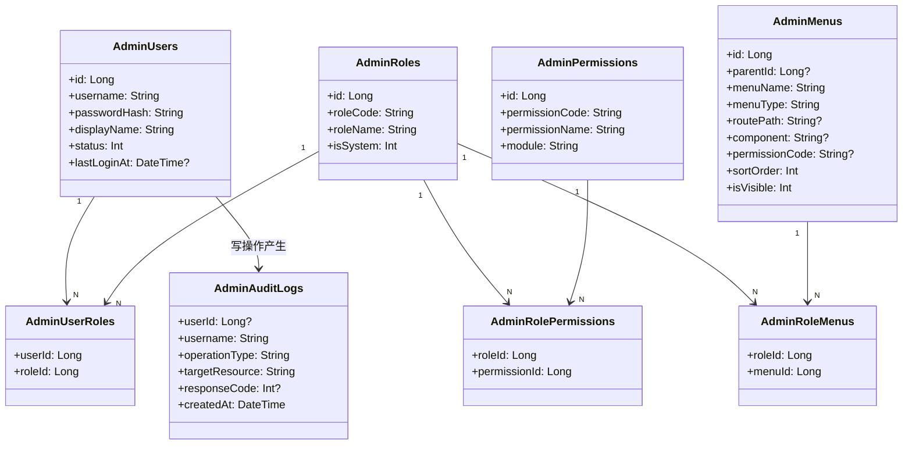

#### 11.1.2 业务基础数据（门店 / 科室 / 医生 / 排班）

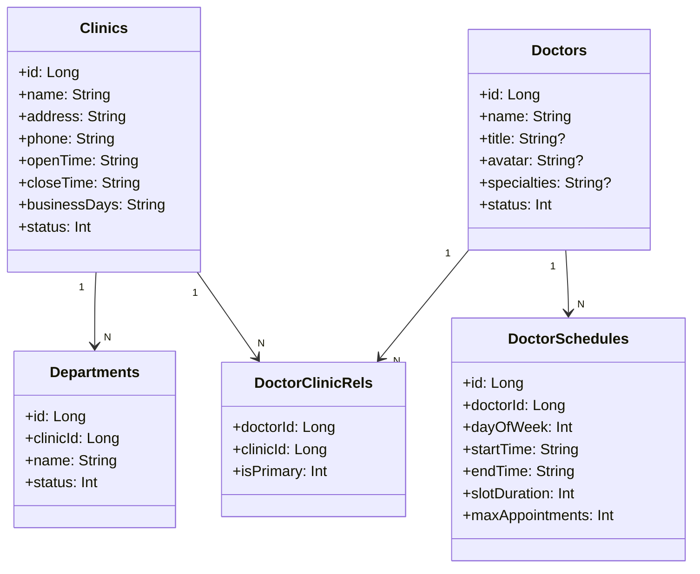

#### 11.1.3 用户 / 会员 / 钱包 / 消费

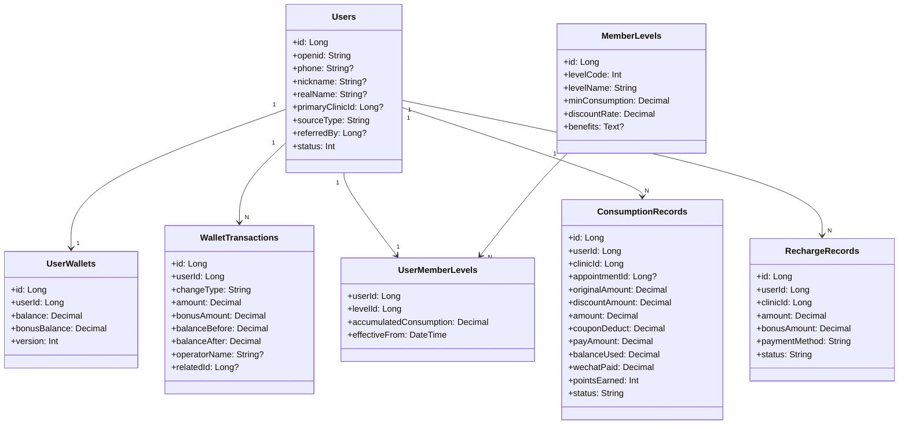

> 钱包流水 `wallet_transaction` 与 `admin_audit_log` 分表：审计日志 90 天清理，资金凭证只追加不修改，覆盖"流水累加 = 钱包当前余额"对账等式。

#### 11.1.4 预约 / 积分 / 推荐 / 优惠券 / 消息 / 内容

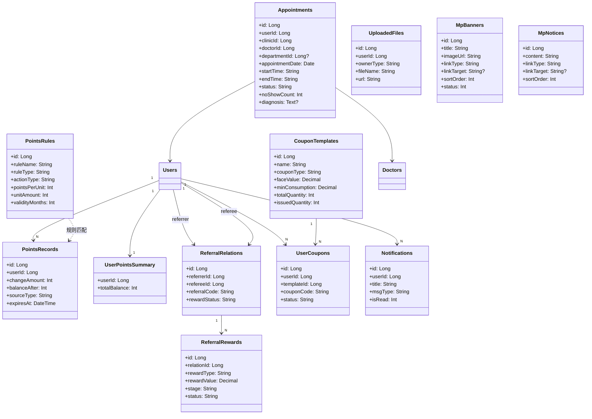

### 11.2 后端服务依赖类图

`AdminModule` 与 `UserModule` 各自手工 `new` 一组 service 实例并注入到路由；`common/` 包提供共享服务避免包循环。

```mermaid
classDiagram
  class AdminModule {
    +adminRouting()
    +installAdminStatusPages()
    +configureAdminStaticFiles()
  }
  class UserModule {
    +userRouting()
  }

  class AdminAuthService
  class AdminUserService
  class AdminRoleService
  class AdminMenuService
  class AdminDashboardService
  class AdminPointsService
  class AdminCouponService
  class AdminReferralService
  class ConsumptionAdminService
  class ClinicService
  class DepartmentService
  class DoctorService
  class ScheduleService
  class AppointmentAdminService
  class CustomerService
  class AdminContentService
  class AdminCleanupService
  class DataSeedService

  class UserAuthService
  class UserProfileService
  class AppointmentService
  class MedicalRecordService
  class ConsumptionRecordService
  class RechargeService
  class PointsService
  class ReferralService
  class CouponService
  class NotificationService
  class ContentService

  class FileUploadService
  class ReferralRewardService
  class BaseService
  class DBConfig
  class SchemaMigration
  class GlobalConfig

  AdminModule ..> AdminAuthService
  AdminModule ..> AdminUserService
  AdminModule ..> AdminRoleService
  AdminModule ..> AdminMenuService
  AdminModule ..> AdminDashboardService
  AdminModule ..> AdminPointsService
  AdminModule ..> AdminCouponService
  AdminModule ..> AdminReferralService
  AdminModule ..> ConsumptionAdminService
  AdminModule ..> ClinicService
  AdminModule ..> DepartmentService
  AdminModule ..> DoctorService
  AdminModule ..> ScheduleService
  AdminModule ..> AppointmentAdminService
  AdminModule ..> CustomerService
  AdminModule ..> AdminContentService
  AdminModule ..> AdminCleanupService
  AdminModule ..> DataSeedService
  AdminModule ..> FileUploadService
  AdminModule ..> DBConfig
  AdminModule ..> SchemaMigration

  UserModule ..> UserAuthService
  UserModule ..> UserProfileService
  UserModule ..> AppointmentService
  UserModule ..> MedicalRecordService
  UserModule ..> ConsumptionRecordService
  UserModule ..> RechargeService
  UserModule ..> PointsService
  UserModule ..> ReferralService
  UserModule ..> CouponService
  UserModule ..> NotificationService
  UserModule ..> ContentService
  UserModule ..> FileUploadService

  ConsumptionAdminService ..> AdminPointsService : 触发积分发放
  ConsumptionAdminService ..> ReferralRewardService : 首消奖励
  CustomerService ..> AdminPointsService
  ReferralService ..> PointsService
  ReferralService ..> ReferralRewardService : 注册奖励

  FileUploadService --> BaseService : 复用
  ReferralRewardService --> BaseService : 复用
```

### 11.3 后端鉴权类图

管理端 JWT 携带 permissions 用于 RBAC；C 端 JWT 只校验身份，鉴权链路不对称。

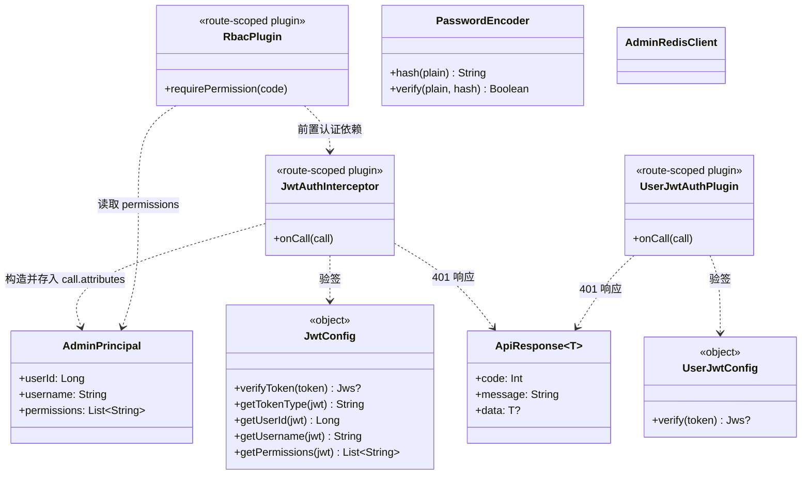

### 11.4 管理后台类结构

聚焦登录、权限、路由三个核心模块；`requestClient` 是所有业务 API 的统一底层。

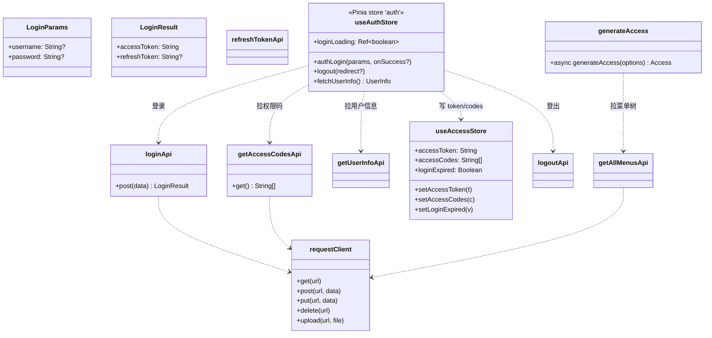

### 11.5 小程序工具类结构

`request.ts` 是请求中枢，`USE_MOCK` 开关决定走真实后端还是 `mockApiService`；`resolveFileUrl` 把后端相对路径补成小程序可渲染的绝对地址。

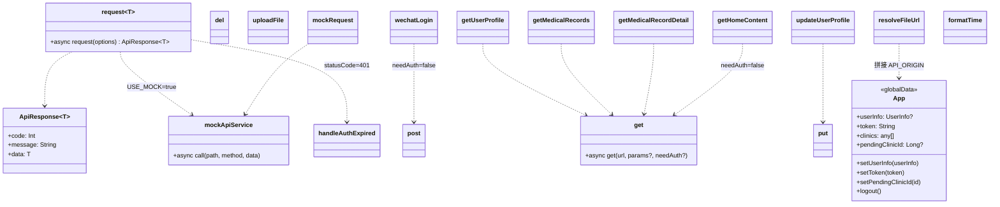

### 11.6 关键业务时序图

#### 11.6.1 管理端登录与菜单加载

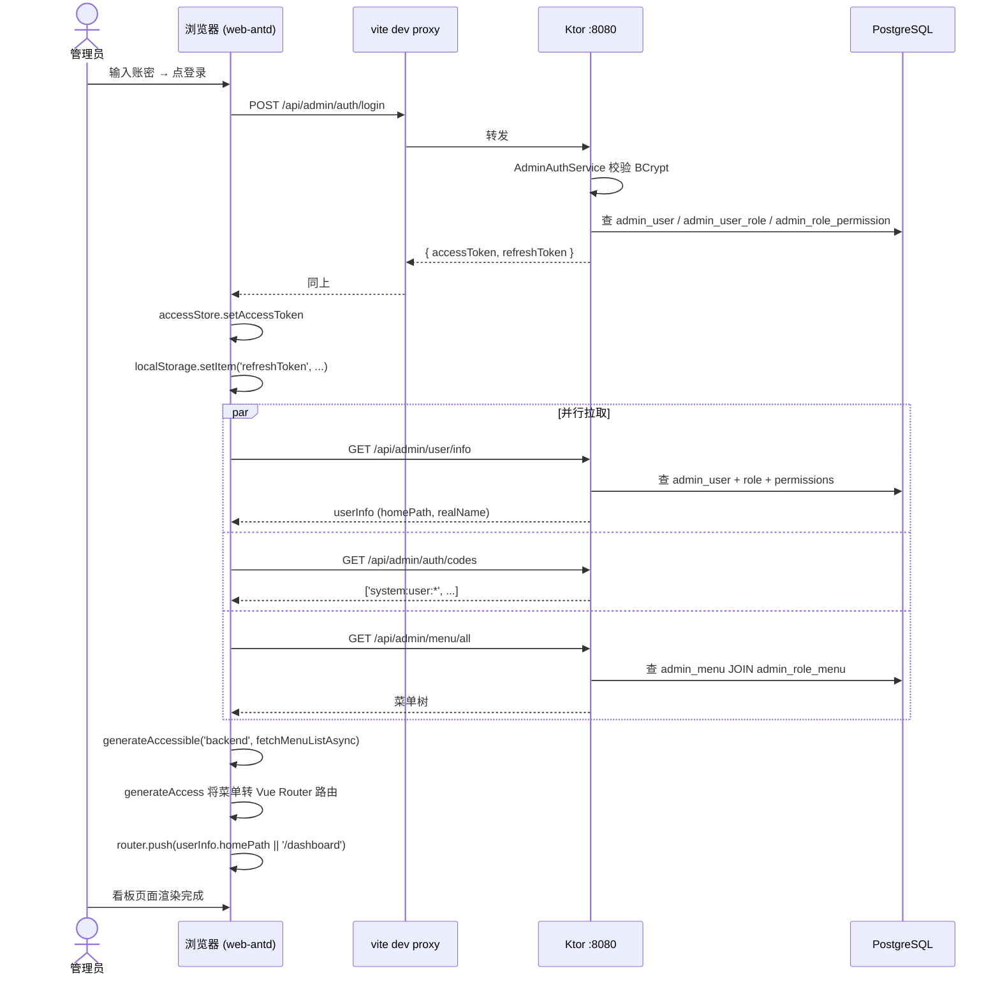

#### 11.6.2 小程序微信登录（mock）

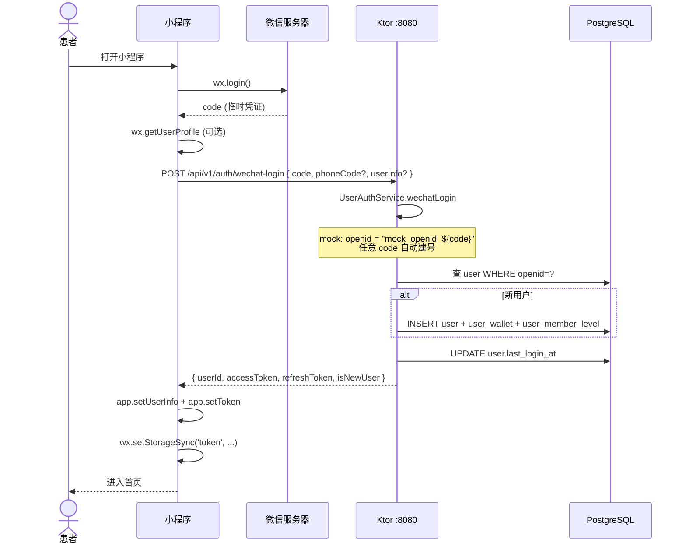

#### 11.6.3 小程序 5 步预约

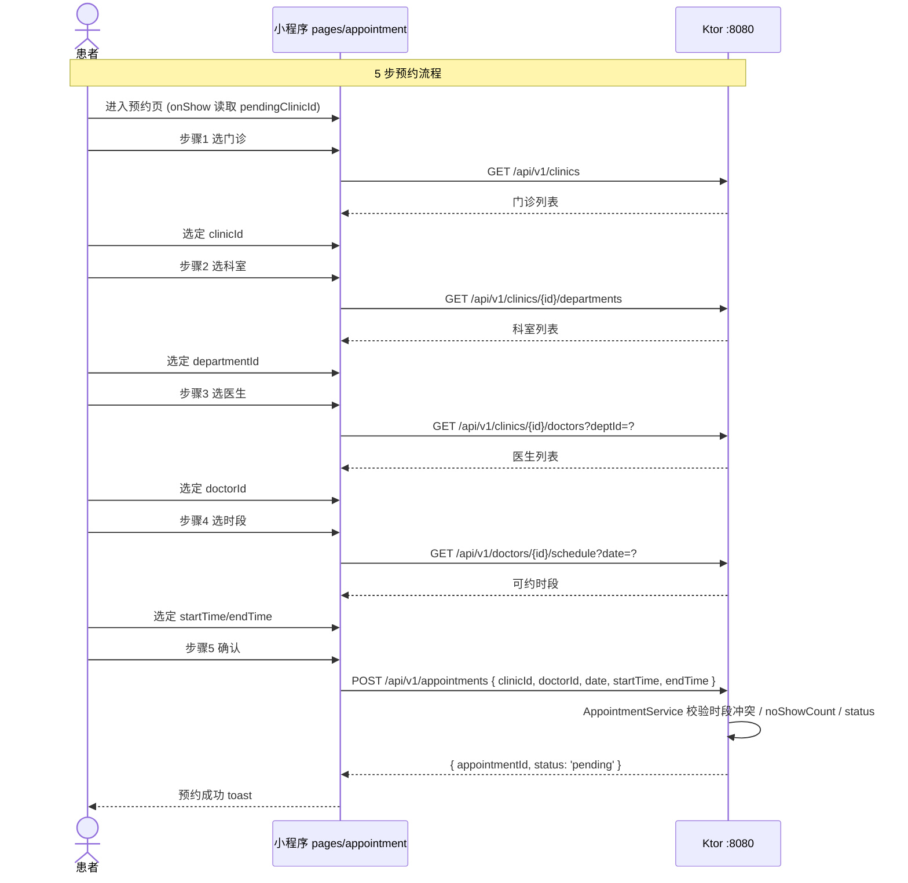

#### 11.6.4 消费录入触发积分与推荐奖励

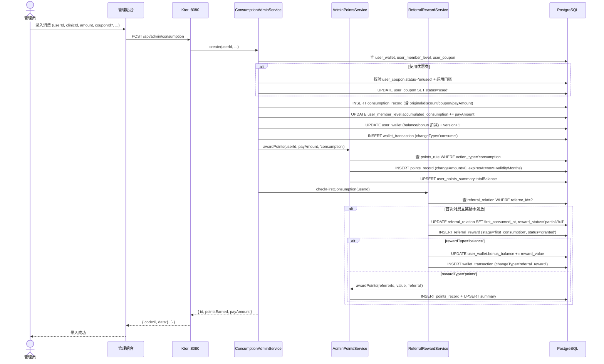

#### 11.6.5 充值流程（mock 微信支付）

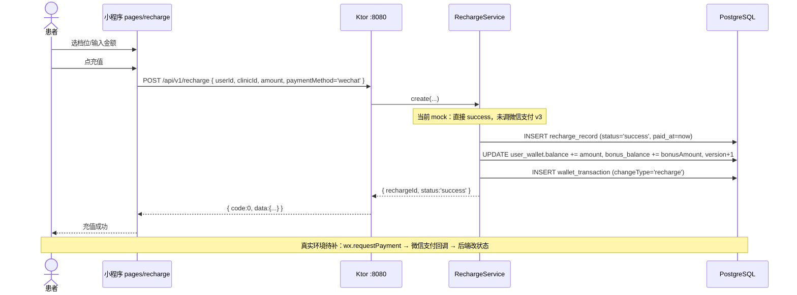

#### 11.6.6 文件上传链路

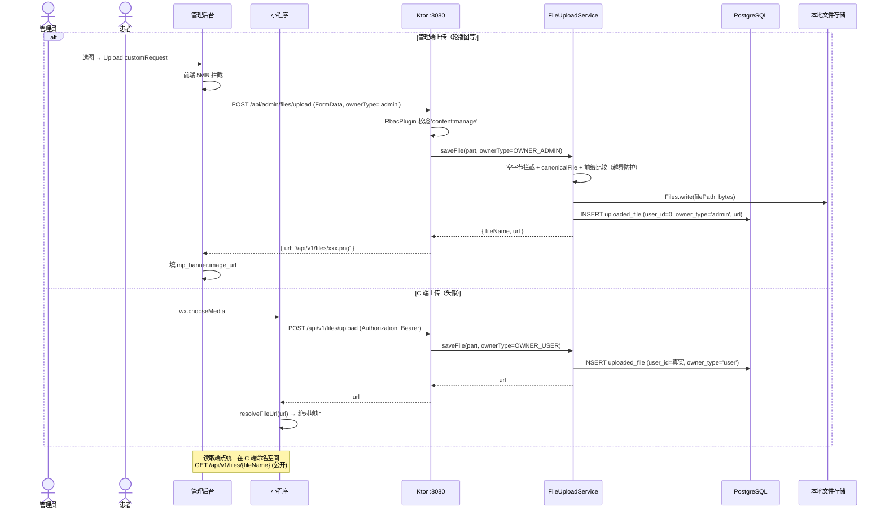

#### 11.6.7 首页内容配置与展示

```mermaid
sequenceDiagram
  actor A as 管理员
  participant W as 管理后台 /content/banner
  participant K as Ktor :8080
  participant ACS as AdminContentService
  participant CS as ContentService
  participant DB as PostgreSQL
  actor U as 患者
  participant MP as 小程序 pages/index

  A->>W: 录入轮播图 (title, imageUrl, linkType, linkTarget, 排期)
  W->>K: POST /api/admin/banners
  K->>K: RbacPlugin 校验 'content:manage'
  K->>ACS: createBanner(...)
  ACS->>ACS: validateBanner (linkType∈ALL, webview需https, endAt≥startAt)
  ACS->>DB: INSERT mp_banner
  K-->>W: { id }

  Note over U,MP: C 端首页拉取（未登录也可访问）
  U->>MP: 打开小程序首页 (onShow)
  MP->>K: GET /api/v1/content/home (公开, 不带 token)
  K->>CS: getHomeContent()
  CS->>DB: SELECT * FROM mp_banner WHERE status=1 AND 排期生效 ORDER BY sort_order LIMIT 10
  CS->>DB: SELECT * FROM mp_notice WHERE status=1 AND 排期生效 ORDER BY sort_order LIMIT 5
  CS-->>K: { banners, notices }
  K-->>MP: { banners:[...], notices:[...] }

  MP->>MP: resolveFileUrl(banner.imageUrl) → 绝对地址
  MP->>MP: <image wx:if> 渲染轮播; 公告纵向 swiper
  MP-->>U: 首页展示
```

#### 11.6.8 推荐裂变：注册 → 首次消费奖励

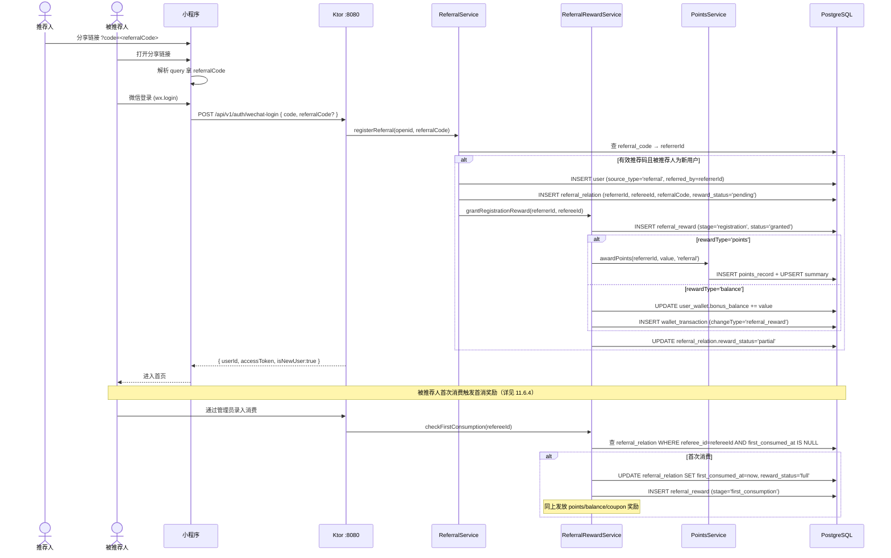

#### 11.6.9 数据库初始化时序

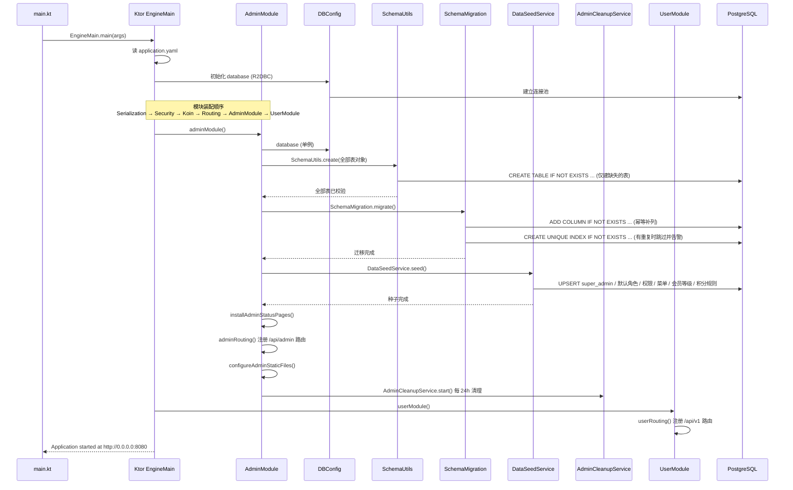

#### 11.6.10 C 端 401 鉴权失效处理

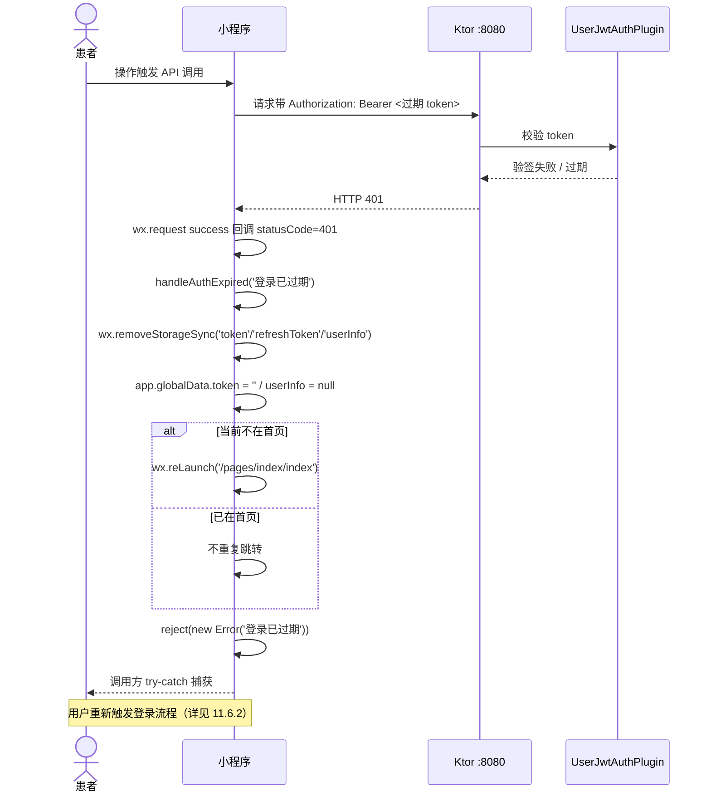

---

## 附录 · 关键约束与设计取舍

1. **数据库初始化双轨**：`SchemaUtils.create()` 只建缺失的表，不给已存在表补列 → 由 `SchemaMigration.migrate()` 用 `ADD COLUMN IF NOT EXISTS` 显式补列与索引，全程幂等。
2. **包循环避免**：`FileUploadService`、`ReferralRewardService`、`BaseService` 下沉到 `common/`，因为 user 包已依赖 admin 包，admin 反向 import user.service 会形成循环。
3. **owner_type 区分归属**：`uploaded_file.user_id` NOT NULL，管理端上传约定写 0 并用 `owner_type='admin'` 区分；删除时同时比对 userId 与 ownerType，避免管理员互删或 C 端用户碰到管理端文件。
4. **资金流水只追加**：`wallet_transaction` 不修改不删除，覆盖要求「流水累加 = 钱包当前余额」；与 `admin_audit_log` 分表，因审计日志 90 天清理而资金凭证需长期可追溯。
5. **金额字段口径**：`originalAmount → discountAmount → couponDeduct → payAmount → (balanceUsed + wechatPaid)`，看板营收统计按 `amount`（折后消费金额）汇总，消费积分以 `payAmount` 为基数。
6. **积分小数比率**：`points_rule.unitAmount + pointsPerUnit` 表达「每 unitAmount 个单位积 pointsPerUnit 分」，规避整型列无法存 0.5 的小数比率（如每充 1 元积 0.5 分 = unit_amount=2 + points_per_unit=1）。
7. **后端鉴权不对称**：admin 端 JWT 携带 permissions 用于 RBAC，C 端 JWT 只校验身份不做权限；`wechatLogin` 当前为 mock，任意 code 自动建号发 token。
8. **菜单完全后端下发**：`accessMode: 'backend'`，前端不维护静态路由模块；新菜单需在 `DataSeedService` 中 seed 或由管理员在「系统管理 → 菜单管理」录入，super_admin 启动时自动补齐全部权限与菜单。
9. **首页内容默认空**：`mp_banner`/`mp_notice` 初始为空（有意不 seed 假 URL 避免死链），管理员录入后小程序首页才展示；小程序侧对空列表用 `wx:if` 兜底整块不渲染。
10. **路径越界防护**：`FileUploadService.getFilePath` 用空字节拦截 + canonicalFile + 带分隔符前缀比较，防止 `../` 越权访问。
